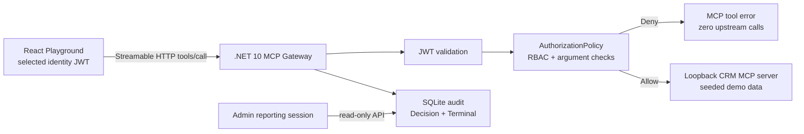
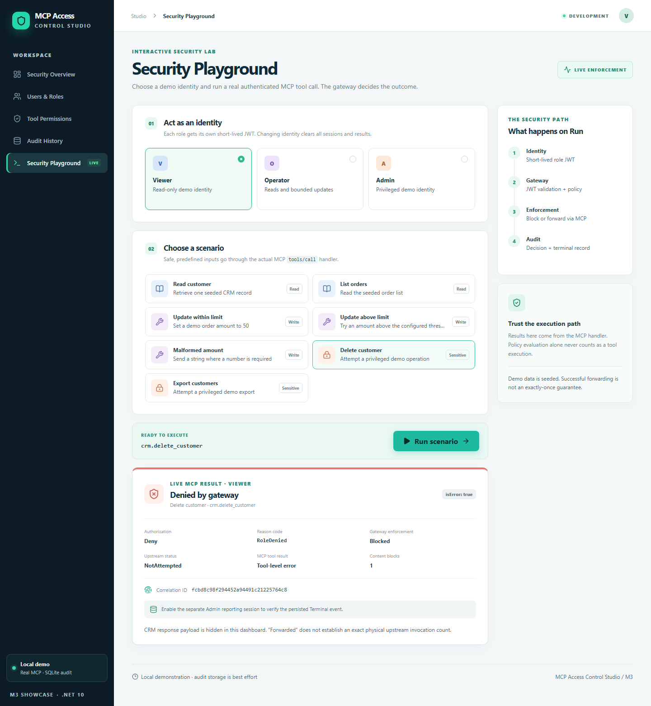
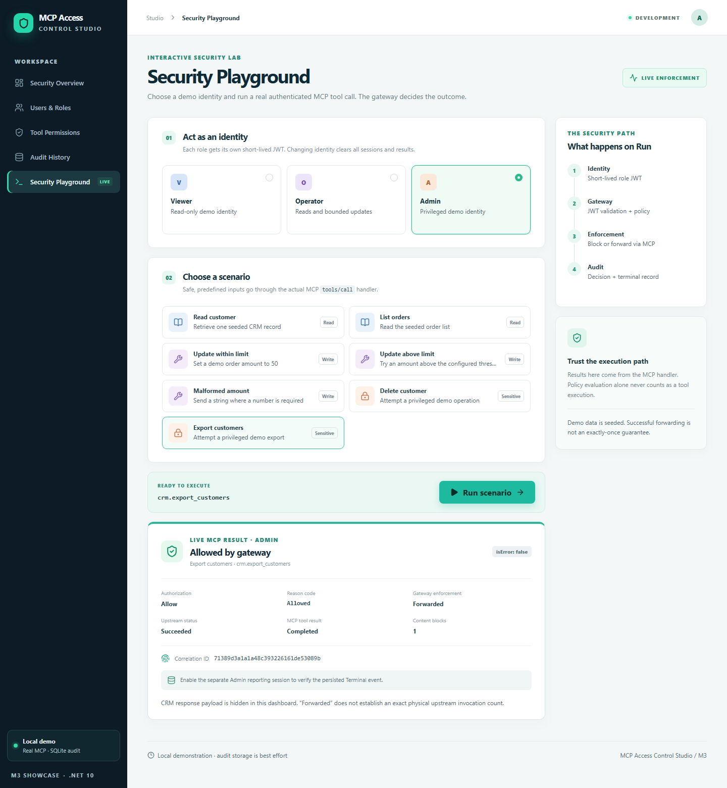
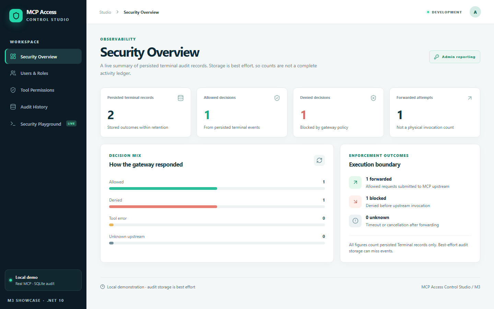
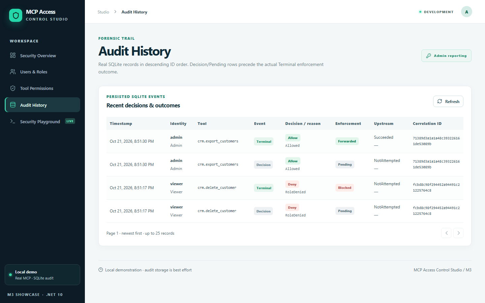
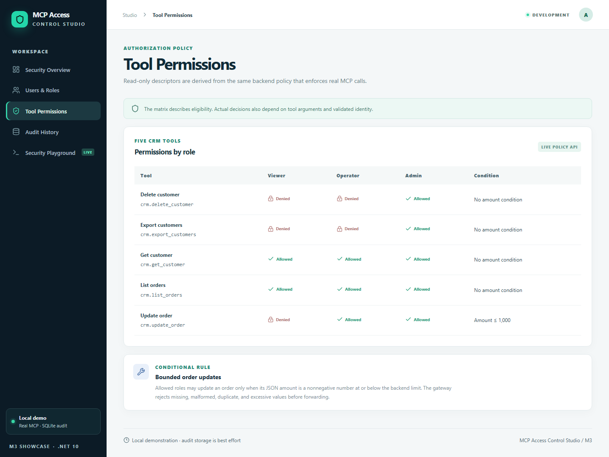

# MCP Access Control Studio

**See who can call an MCP tool, why a call was blocked, and what actually reached the upstream.** MCP Access Control Studio is a local .NET 10 and React showcase for identity-aware MCP authorization. Its Playground executes real authenticated Streamable HTTP `tools/call` requests; the dashboard reads the same gateway policy and persisted security audit used by those calls.

> **v0.1.0 release candidate — local demonstration, not production ready.** The seeded identities, CRM data and loopback token issuer are for evaluation. See [security limits](#security-boundaries-and-limitations) and the [threat model](docs/threat-model.md).

[MCP Sentinel](https://github.com/DarkExpert/mcp-sentinel) is a separate project focused on MCP gateway and security engineering patterns. This Studio is a visual, identity-aware authorization and audit demonstration. It reuses proven SDK integration ideas without copying Sentinel's gateway or changing that repository.

## What works today

- JWT validation and default-deny RBAC with a conditional amount rule, enforced inside the real MCP call handler before upstream forwarding.
- Five seeded CRM MCP tools: `crm.get_customer`, `crm.list_orders`, `crm.update_order`, `crm.delete_customer` and `crm.export_customers`.
- A React dashboard with Security Overview, Users & Roles, Tool Permissions, Audit History and Security Playground.
- Viewer, Operator and Admin Playground scenarios using each selected identity's own short-lived JWT. The UI displays gateway decision, reason, enforcement and correlation ID from actual MCP responses.
- SQLite Decision and Terminal events with a 20,000-row retention cap. Admin-only, read-only overview, paginated audit and direct Terminal correlation lookup APIs.
- Automated authorization regressions, a real MCP SDK demo, browser E2E verification and Linux GitHub Actions CI.

## Architecture



The CRM upstream is bound to an ephemeral loopback port inside the API process. The browser never calls it directly. The Admin reporting token is separate from the Playground execution token; it never replaces a Viewer or Operator credential. [Architecture details](docs/architecture.md).

## Run locally with one command

Prerequisites: **.NET SDK 10**, **Node.js 24+** and network access for first-run NuGet/npm restore. From the repository root:

```text
node scripts/run-studio.mjs
```

Open **http://127.0.0.1:5173/**. The command restores/builds .NET, installs pinned web dependencies, generates a random signing key, and starts the API at `127.0.0.1:5077` and Vite at `127.0.0.1:5173`. Demo audit data persists in ignored `.local-data/`; stop both services with Ctrl+C. Keep this Development workflow on your local machine, with no public reverse proxy.

In **Security Playground**, select Viewer and **Delete customer** to see a real denial. Select Admin and **Export customers** to see a permitted call. Open **Security Overview**, explicitly enable Admin reporting, and inspect persisted totals and Audit History. **Tool Permissions** loads descriptors from the enforcing backend policy.

## Real application screenshots

Captured by [the Playwright showcase script](apps/studio-web/scripts/capture-showcase.mjs) against a running local gateway and browser. The outcomes and audit counts came from real MCP calls and SQLite records.

| Viewer denied | Admin allowed |
| --- | --- |
|  |  |

| Persisted overview | Audit history | Tool permissions |
| --- | --- | --- |
|  |  |  |

[Watch the unedited Playwright source recording](docs/assets/showcase-v0.1.0.webm) (WebM, roughly 80 seconds). To regenerate the screenshots and recording after a Release build and `npm ci`, run `npm run capture:showcase` in `apps/studio-web`. The [recording storyboard](docs/demo-storyboard.md) explains each genuine scenario. No browser developer tools, JWTs or CRM payloads appear in the assets.

## Verify

```text
dotnet restore
dotnet build -c Release --no-restore
dotnet test -c Release --no-build
pwsh -File ./scripts/run-demo.ps1
cd apps/studio-web
npm ci
npm test
npm run build
npx playwright install chromium
npm run e2e
```

`npm run build` includes TypeScript checks. The demo exercises real SDK calls for all roles and verifies SQLite persistence across an API restart. Browser E2E checks role separation, real outcomes, Admin reporting and correlation lookup. [CI](.github/workflows/dotnet.yml) runs these checks on Linux. See the [release verification checklist](docs/release-checklist.md) for exact results and manual review steps.

### Windows Application Control troubleshooting

If `dotnet build` succeeds but `dotnet test` or the API cannot load a rebuilt assembly with `FileLoadException` and `0x800711C7`, record the exact command and error. That is an OS execution restriction, not a compiler diagnostic. Do not disable or weaken Application Control. Run the same verification in an approved Linux environment or use the repository's GitHub Actions workflow. A separate `MSB3027` copy failure means a process has the output DLL open; identify and stop only a stale demo API process from this workspace before rebuilding.

## Security boundaries and limitations

- The unauthenticated demo token issuer exists only in Development and issues tokens only to loopback transport peers. It does **not** trust forwarded IP headers. A reverse proxy on loopback can make remote users appear local; never expose this workflow through one.
- Browser JWTs stay in memory, expire after ten minutes and are cleared on identity changes. They are absent from URLs, browser storage and application logs. Development CORS allows only `http://127.0.0.1:5173`; CORS is not authentication.
- A cryptographically random signing key of at least 32 UTF-8 bytes must be supplied outside the repository. Key length alone cannot prove entropy. There is no production identity provider or key rotation.
- Denied authenticated tool calls have zero upstream invocations. After a permitted call is forwarded, cancellation or SDK continuation can leave the physical outcome uncertain; **exactly-once execution is not guaranteed**.
- SQLite audit is **best effort**. Storage failure cannot alter forwarding or trigger a second invocation, but events may be missing. Overview numbers count persisted Terminal rows only, not guaranteed complete activity.
- A local process can contact the loopback CRM listener directly. Host isolation would be required for real data. The demo includes no enterprise identity, multi-tenancy, cloud deployment or production hardening certification.

The [threat model](docs/threat-model.md), [changelog](CHANGELOG.md) and [draft release notes](docs/release-notes-v0.1.0.md) state the remaining risks. This repository includes an [MIT license](LICENSE).
